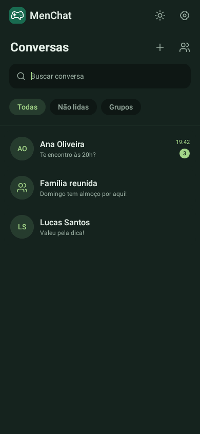
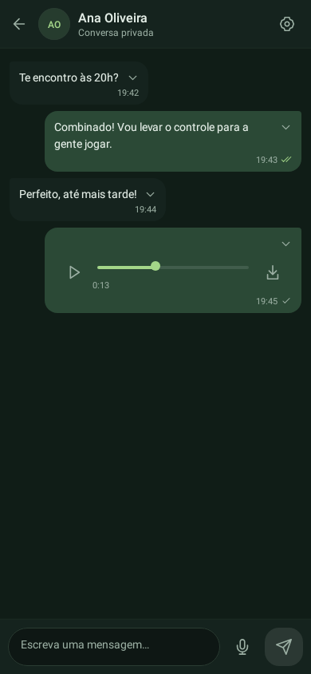
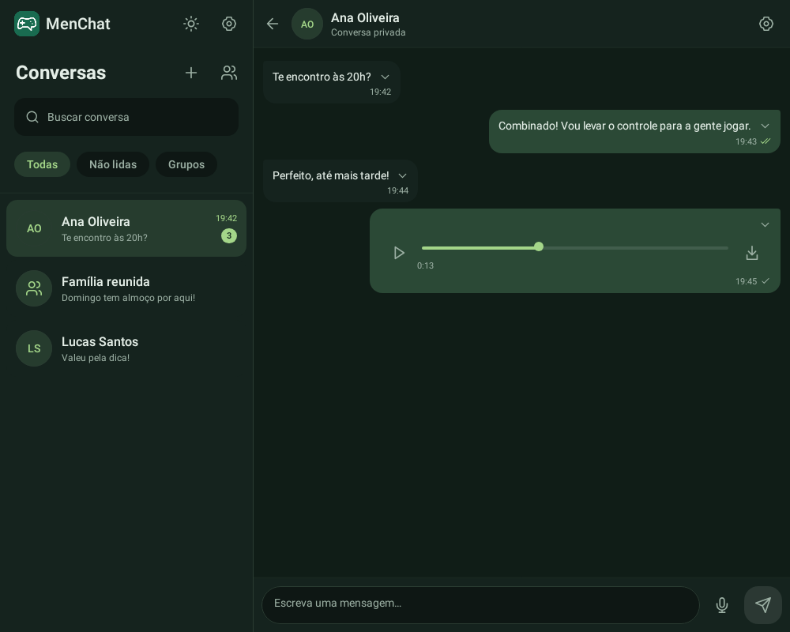

# Android 2.1.0 — interface baseada na web

A versão atual é a [2.2.0, com câmera, anexos e perfil](android-midia-perfil-2.2.md). Este documento preserva a entrega 2.1.0.

Esta entrega conclui o reboot visual da etapa 2 do [roteiro de paridade](roteiro-paridade-android.md), preservando a integração real existente. O APK continua nativo em Kotlin/Compose, sem WebView ou abertura do Chrome para o chat.

## O que mudou

- Paleta clara/escura igual à web, marca MenChat e tipografia do sistema, sem downloads de fontes.
- Lista com linhas compactas, busca local, filtros Todas/Não lidas/Grupos, horários do servidor e contadores de mensagens não lidas. Tema e engrenagem visíveis.
- Celular alterna entre lista e conversa. A partir de 840 dp, lista fixa à esquerda e conversa ocupando o restante da tela.
- Balões com largura proporcional, cores da web, seta no canto superior direito e menu ancorado. Respostas e exclusões preservadas; confirmações distinguem gravada, recebida e lida conforme os dados/preferências do servidor.
- Campo de mensagem mais compacto, microfone à direita e ícones em traço. Gravação continua começando no toque e sendo enviada pela seta; descartar e limites atuais preservados.
- Áudio com barra fina, reprodução/pausa e download visível; prévias de imagem sem nome de arquivo. Nenhum recarregamento de mídia apenas por polling.
- Login com marca e formulário; conta em painel inferior com nome/status/código, tema e saída. Avisos de sincronização ficam abaixo do cabeçalho.
- Tratamento de fonte ampliada, teclado/insets e orientação. Permissão de microfone tardia só inicia gravação na conversa que a solicitou e com app em primeiro plano.

A etapa preserva as funções que o nativo já tinha. Câmera/galeria/anexos novos, edição de foto/perfil, administração completa de grupos, convites no nativo, som/push nativo e chamadas continuam nas etapas seguintes. Esses botões não foram apresentados como ações disponíveis nesta entrega. A versão web mantém seus recursos.

## Instalação e conferência no Poco

1. Aguarde o último deploy da Vercel ficar Ready.
2. No site, escolha **Baixar app Android**, ou baixe `/downloads/menchat-2.1.0.apk`.
3. Instale por cima da versão anterior, mantendo a sessão/dados do aplicativo. Mesma assinatura/pacote, versionCode 6.
4. Confira **MenChat 2.1.0** na engrenagem. Não exige SQL, novas chaves ou alteração do Supabase.
5. Teste lista/busca/filtros, abertura do mesmo privado/grupo, texto, resposta, exclusão, gravação e reprodução/download. Alterne tema e reinicie para verificar a preferência salva.
6. Confira teclado aberto, fonte ampliada e rotação. O comportamento físico do Poco precisa ser validado no aparelho; renderização simulada não substitui esse teste.

## Referência visual

Capturas produzidas pelo próprio código Compose em Robolectric, com dados fictícios exclusivos dos testes. Não representam conversas reais.

## Verificações

Testes nativos de interface cobrem busca/filtros, menu sem deslocar o histórico, resposta, gravação/envio pela seta, transição de foco, duas colunas, fonte ampliada, login e troca de tema. Os contratos de Auth, renovação, visibilidade/exclusão do histórico e liberação do microfone continuam na suíte nativa. Testes usam contas/serviços locais simulados, sem criar acesso alternativo na aplicação.

Conferir no release: pacote `app.menchat.android`, versionName 2.1.0, versionCode 6, certificado anterior, alinhamento ELF/ZIP de 16 KB, nenhuma Activity de testes no manifesto e nenhum segredo administrativo. O manifesto de suporte à UI de teste é somente da variante debug.

Resultado desta entrega: 33 testes Android simulados (oito de interface), lint, tipos, build web, 58 testes Node, 27 testes de navegação e três testes de instalação web aprovados. Assinatura, versão, manifesto e alinhamento ELF/ZIP de 16 KB conferidos no APK release. Verificação do Supabase hospedado e do Poco físico continua pendente.
