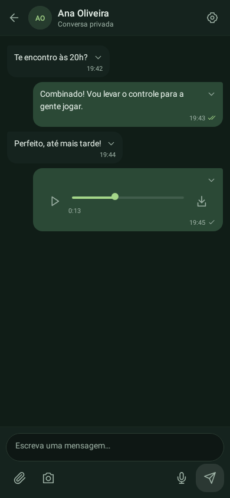
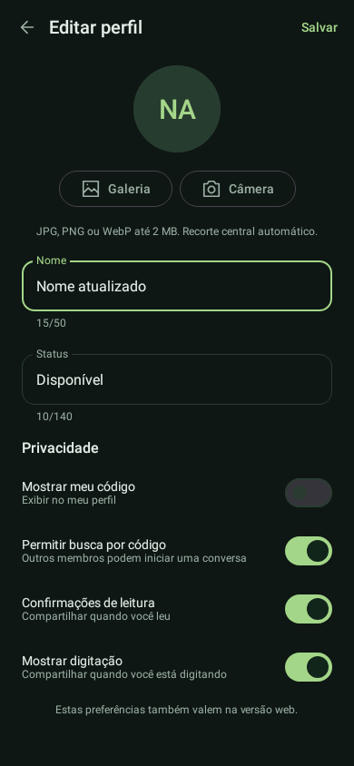

# Android 2.2.0 — câmera, anexos e perfil

Entrega 3A do [roteiro de paridade Android/web](roteiro-paridade-android.md). Preserva o chat Kotlin/Compose e a versão web. Usa as contas, conversas, reservas e políticas RLS existentes, sem migração SQL ou novas chaves na Vercel.

## Instalar e testar no celular

1. Aguarde o deploy da Vercel ficar **Ready**.
2. Abra [MenChat](https://men-chat.vercel.app/entrar) → **Baixar app Android** → **Baixar APK Android · versão 2.2.0**.
3. Abra o arquivo baixado e escolha **Atualizar**. Instale por cima da versão anterior; não desinstale. Pacote `app.menchat.android`, versionCode 7 e mesma assinatura.
4. Na engrenagem, confira **MenChat 2.2.0**.
5. Na conversa, o **clipe** oferece fotos/vídeos, documento e arquivo de áudio. Escolha um arquivo, confira o rascunho e envie pela seta. O × descarta o anexo. Nenhum upload acontece apenas por selecionar.
6. O botão de **câmera** oferece foto e vídeo. Abre a câmera do Android e retorna ao MenChat para prévia/envio. Não abre o Chrome. Vídeo capturado: até dois minutos e 25 MB; o app também verifica o limite ao receber a captura, mesmo se a câmera ignorar a solicitação.
7. Toque na foto para ampliar com dois dedos. **Reproduzir vídeo** abre o player dentro do aplicativo. Fechar/sair interrompe a reprodução. Downloads são salvos somente após escolher o destino no seletor do Android.
8. Engrenagem → **Editar perfil**: nome, status, foto pela galeria/câmera, remoção da foto e quatro preferências de privacidade. **Salvar** atualiza a conta compartilhada com a web. Voltar fecha o editor sem enviar as alterações locais; não desfaz uma operação que o servidor já confirmou/recebeu antes de uma falha de conexão.
9. Confira a mensagem/anexo e o perfil no site com a mesma conta; envie mídia no site e confira no APK. Teste privado e grupo já existentes, tema claro/escuro, teclado, rotação, cancelar a câmera e negar acesso no seletor.

A câmera e o seletor usam as telas próprias do Android. O app recebe apenas o arquivo escolhido/capturado, sem acesso geral à galeria nem permissões amplas de armazenamento. A foto de perfil recebe recorte central automático; não há editor manual de recorte nesta entrega.

## Limites, falhas e privacidade

- Fotos até 5 MB; vídeos até 25 MB; áudio e documentos até 10 MB. Tipos permitidos seguem o servidor: JPG/PNG/WebP/GIF, MP4/WebM/MOV, MP3/M4A/OGG/WAV/WebM, PDF/texto/ZIP/Word/Excel. Reprodução de vídeo/áudio depende dos codecs do dispositivo.
- Foto de perfil original da galeria até 2 MB, JPG/PNG/WebP; normalizada para WebP 256 × 256/200 KB, com orientação corrigida e sem metadados de localização. Fotos capturadas são redimensionadas e têm metadados removidos antes do rascunho.
- Upload por streaming, reserva autenticada, objeto sem sobrescrita e publicação pela RPC existente. As cotas continuam 100 MB por conta/24 horas, cinco pendentes/hora e 500 MB globais. Avisos de cota não exibem o corpo privado do erro remoto.
- Falha antes da publicação mantém o arquivo para nova tentativa. Se a resposta da publicação for ambígua, o app congela o rascunho: **Tentar enviar novamente** primeiro procura a mensagem pelo mesmo ID; se necessário, repete a publicação com o mesmo conteúdo e sem reenviar o objeto. **Descartar tentativa** não apaga uma mensagem que já tenha sido entregue.
- Edição de perfil conserva as preferências existentes, incluindo valores desativados. Uma repetição após falha no salvamento reaproveita a foto já enviada. Depois da confirmação da nova foto, tenta remover a antiga; falhas de limpeza remota não apagam a foto atual.
- Arquivos de rascunho ficam no cache privado do Android, não são um arquivo offline de conversas. São descartados ao concluir/remover/trocar de conversa/sair; órfãos locais com mais de 24 horas são limpos ao inicializar. Encerramento do processo pode perder rascunhos/tentativas: a preservação de reenvio descrita acima vale na sessão em memória. Reservas remotas órfãs continuam sujeitas à limpeza administrativa.
- FileProvider não exportado compartilha somente `cache/menchat-capture/` com a câmera. Retorno tardio de outra conta/conversa é descartado; arquivos não são anexados silenciosamente a um contato diferente.
- Imagens privadas não usam cache em disco do Coil. URLs assinadas expiram em cinco minutos; miniaturas/fotos de perfil renovam a URL enquanto visíveis, sem nova consulta a cada polling. Visualizadores e seletores impedem confirmar leitura do histórico encoberto.

## Verificação e arquivos

Código: `NativeSelections.kt` (contratos do Android), `NativeLocalMedia.kt` (validação/preparo), `Gateway.kt`/`MainModel.kt` (reservas, envio, perfil e tentativas), `NativePreview.kt` (foto/vídeo/áudio local), `NativeProfile.kt` (editor) e componentes `NativeChat/Media/Design/Inbox/Screens`. Manifesto/`capture_paths.xml` restringem o compartilhamento. Site, testes e checksum apontam para o APK 2.2.0.

```bash
npm run lint
npm run typecheck
npm test
npm run test:e2e
npm run test:real-ui -- tests/real-ui/message-menu.spec.ts -g "instalar no celular"
```

No diretório `android`, com JDK 21, Android SDK/Build Tools 36.0.0 e as variáveis privadas de assinatura já configuradas:

```bash
./gradlew :nativeApp:testDebugUnitTest :nativeApp:assembleRelease
```

APK: `nativeApp/build/outputs/apk/release/nativeApp-release.apk`. Conferir assinatura anterior, pacote/versão, manifesto release sem Activity de testes, FileProvider restrito e alinhamento ELF/ZIP de 16 KB. Nunca versionar keystore/senhas.

Resultado: 56 testes Android simulados (13 de interface), lint, tipos, build web, 58 testes Node, 27 testes de navegação e três testes de instalação web aprovados. APK release com mesma assinatura, versionCode 7, manifesto/ausência de fixtures e alinhamento ELF/ZIP de 16 KB verificados.

As capturas abaixo são renderizadas pelo código Compose com dados fictícios exclusivos dos testes:





Testes simulados não comprovam a câmera do Poco nem a integração hospedada. Não há credenciais de produção ou aparelho físico neste ambiente; a conferência dos passos 5–9 permanece necessária antes de ampliar a distribuição.

## Próximas entregas

A etapa 3B ainda inclui administração completa de grupos, convites no nativo, favoritos, menções, emojis e figurinhas. Primeiro acesso/recuperação de senha continuam na web. Depois vêm som/push Android e chamadas WebRTC privadas/em grupo. O APK 2.2.0 não oferece essas chamadas nem notificações nativas com o app fechado. A gravação de áudio já existente e o Web Push do site são preservados.
